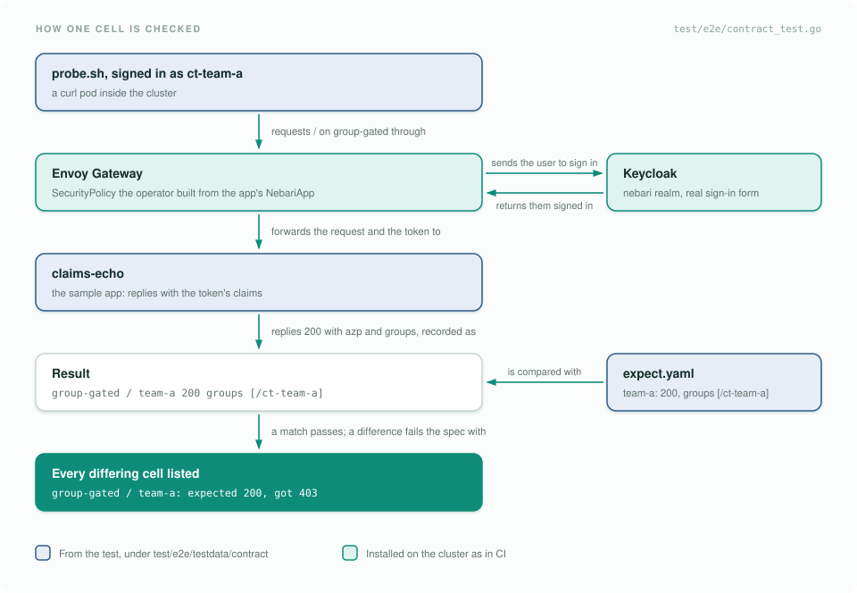

# What we test

A green check on a pull request proves different things depending on which job ran. This page explains what
each test layer proves, how to run it on your machine, what a failure looks like, and what it does not cover.
Use it to judge what a green run is worth, and to decide where a new test belongs. It links to the tests
instead of listing them, so the source stays the reference.

## Overview

| Layer | Question it answers | Run it | CI job |
| --- | --- | --- | --- |
| Lint and generated files | Is the code clean, and are CRDs, RBAC, deepcopy, the API reference and `AGENTS.md` regenerated? | `make fmt vet lint`, `make generate-dev docs agents` | Lint and Validate |
| Unit tests | Does each reconciler do its own job against a real API server? | `make test` | Unit Tests |
| End-to-end tests | Does the operator work on a real cluster with Envoy Gateway, cert-manager and Keycloak? | `make test-e2e` | E2E Tests |
| Pack contract matrix | Do packs and their users still get what they got before? | part of `make test-e2e` | E2E Tests |
| Helm chart tests | Does the `nebari-app` library chart still render the same manifests? | `make helm-test` | Helm Chart Tests |
| Vulnerabilities | Is a known vulnerability reachable from our code when a fix exists? | `make vuln` | Vulnerabilities |

Each layer runs against a different amount of the real platform:

| | Unit | End-to-end | Contract matrix |
| --- | --- | --- | --- |
| Kubernetes API server | envtest | kind | kind |
| Pods run | no | yes | yes |
| Envoy Gateway acts on the objects | no | yes | yes |
| cert-manager | no | yes | yes |
| Keycloak | fake provider | yes | yes |
| A user signs in through the browser flow | no | no | yes |

## Where a new test goes

| You changed | Add or update |
| --- | --- |
| Reconciler logic, status conditions or events | A table-driven unit test next to the code, in the same package |
| Behavior that needs another component to act, such as Envoy Gateway programming a route or Keycloak answering | An e2e spec under [`test/e2e`](../../test/e2e) |
| What a pack or its users get: who can reach a path, which claims an app receives | A cell in a sample app's `expect.yaml`, or a new sample app (see [Pack contract matrix](#pack-contract-matrix)) |
| The `nebari-app` library chart | The goldens, with `make helm-test-generate-golden` |
| `api/v1` types | The generated files, with `make generate-dev docs` |
| A Go dependency or the Go version | Nothing new. `make vuln` checks it |

Never disable or skip a test to get CI green. Fix the cause, or, when the new behavior is intended, update the
expectation in the same PR so reviewers see the change.

## How CI gates a pull request

<picture>
  <source media="(prefers-color-scheme: dark)" srcset="../assets/diagrams/ci-checks-dark.svg">
  
</picture>

`build-pr.yml` runs lint first, then the three test jobs in parallel. The image is built and pushed to
`quay.io/nebari/nebari-operator` only when all three pass and the change touches Go code, `go.mod` or the
`Dockerfile`. The E2E job is capped at 30 minutes.

`build-pr.yml` only runs when a PR touches code, tests, the Makefile, charts or workflows. A PR that changes
only `docs/` gets `test-chart.yml` and nothing else.

Three other workflows run alongside it:

- `vulncheck.yml` runs `make vuln` on pull requests that touch Go code or dependencies, on pushes to `main`,
  and weekly on `main`, because new advisories appear without any change here.
- `test-chart.yml` installs the operator's generated Helm chart on a kind cluster.
- `release.yml` runs fmt, vet, unit tests and lint before it publishes manifests, images and the chart. See
  [release-process.md](release-process.md).

## Unit tests

Unit tests are the fast gate: run them before every push. `make test` runs every package outside `test/e2e`.
The controller suite in `internal/controller` runs against
[envtest](https://book.kubebuilder.io/reference/envtest.html), a real kube-apiserver and etcd with no kubelet,
so objects are created, updated and deleted for real but no pod ever runs. The sub-reconcilers and utilities
are tested next to their code, under `api/v1`, `internal/config` and `internal/controller/...`. Keycloak calls
go through the `OIDCProvider` interface, so the auth reconciler is tested against a fake provider.

### Run them

```bash
make test
```

The target regenerates manifests and runs `go fmt` and `go vet` first. The first run downloads the envtest
binaries into `bin/`. You should see one line per package:

```
ok   github.com/nebari-dev/nebari-operator/internal/config                        0.121s  coverage: 98.0% of statements
ok   github.com/nebari-dev/nebari-operator/internal/controller                    7.476s  coverage: 40.8% of statements
ok   github.com/nebari-dev/nebari-operator/internal/controller/reconcilers/auth   0.254s  coverage: 87.5% of statements
...
ok   github.com/nebari-dev/nebari-operator/internal/controller/utils/groups       0.015s  coverage: 100.0% of statements
```

Packages that do not use envtest also run with plain `go test`, which is quicker while you iterate:

```bash
go test ./internal/controller/reconcilers/auth/...
```

### Not covered

Anything that needs Envoy Gateway to act on a `SecurityPolicy`, a certificate to be issued, or Keycloak to
answer. That is what the end-to-end tests are for.

## End-to-end tests

`make test-e2e` runs the Ginkgo suite in [`test/e2e`](../../test/e2e) against a kind cluster with Envoy
Gateway, cert-manager and Keycloak, and the operator image built from your working tree. It covers:

- reconciliation, status conditions and cleanup on delete;
- routing variations: TLS on and off, path rules, hostnames;
- user-provided TLS secrets and the gateway and cert-manager wiring;
- authentication: Keycloak client provisioning, the `SecurityPolicy`, generic OIDC, and `auth.groups`
  enforced at the gateway;
- validation of bad specs;
- HTTP and HTTPS connectivity through the gateway.

### Run them

The suite needs the same cluster CI builds. First, create a kind cluster with MetalLB, Envoy Gateway,
cert-manager and Keycloak:

```bash
make -C dev setup
```

The tests sign in against the `nebari` realm, which the install leaves for a separate step. Create it:

```bash
dev/scripts/services/keycloak/setup.sh
```

Then run the suite. It builds the operator image, loads it into kind, and deploys it. `KIND_CLUSTER` tells it
which cluster to load the image into, since the dev cluster is not named `kind`:

```bash
KIND_CLUSTER=nebari-operator-dev make test-e2e USE_EXISTING_CLUSTER=true
```

In CI the suite itself takes about 10 minutes. You should see:

```
Ran 51 of 51 Specs in 586.078 seconds
SUCCESS! -- 51 Passed | 0 Failed | 0 Pending | 0 Skipped
```

To run one spec, pass a Ginkgo focus to `go test` with the same variables. For example, the contract matrix:

```bash
KIND_CLUSTER=nebari-operator-dev USE_EXISTING_CLUSTER=true \
  go test ./test/e2e -tags=e2e -v -ginkgo.v -ginkgo.focus="Pack contract matrix" -timeout=30m
```

[`test/e2e/README.md`](../../test/e2e/README.md) lists the other environment variables, such as
`SKIP_DOCKER_BUILD`.

### Not covered

Kubernetes and Envoy Gateway versions other than the ones the dev setup installs, and per-app certificates.
CI deploys the operator without `TLS_CLUSTER_ISSUER_NAME`, so apps are served through the shared wildcard
listener and no per-app `Certificate` is issued.

## Pack contract matrix

The other tests check what the operator creates. The contract matrix checks what packs and their users get.
If a change alters who can reach an app, or what an app learns about the user, a cell fails, even when every
object the operator creates still looks right. The `groups` claim changing to full paths in v0.2.0 is the
kind of change it exists to catch.

Test users (personas) sign in through the real browser flow to sample apps copied from real packs. For every
path, the test records the HTTP result, plus the `azp` and `groups` claims the app receives, and compares
them with the app's `expect.yaml`:

<picture>
  <source media="(prefers-color-scheme: dark)" srcset="../assets/diagrams/contract-flow-dark.svg">
  
</picture>

Repeated for every user, app and path, that gives the matrix. On each app's protected path:

<picture>
  <source media="(prefers-color-scheme: dark)" srcset="../assets/diagrams/persona-matrix-dark.svg">
  
</picture>

It also covers `publicRoutes`: every sample app has a public path that must return 200 to everyone.

### Run it

It runs as part of `make test-e2e`. To run it alone, use the focus command in
[End-to-end tests](#end-to-end-tests). The spec prints the matrix it observed:

```
contract matrix:
gateway-signin   /              anonymous=login no-group=200 team-a=200 team-a-sub=200 team-b=200
gateway-signin   /healthz       anonymous=200 no-group=200 team-a=200 team-a-sub=200 team-b=200
group-gated      /              anonymous=login no-group=403 team-a=200 team-a-sub=403 team-b=403
...
app-login        /hub/health    anonymous=200 no-group=200 team-a=200 team-a-sub=200 team-b=200
```

The spec skips itself when Keycloak or the gateway is missing, so check that the E2E log prints this matrix
before you trust a green run.

### When it fails

The failure lists every cell that differs, not only the first. For example, an operator built with the
pre-v0.2.0 groups mapper fails with something like this:

```
behavior differs from test/e2e/testdata/contract/*/expect.yaml. If the change is intended, update expect.yaml and say so in the PR.
group-gated / team-a: expected 200, got 403
gateway-signin claims team-a groups: expected ["/ct-team-a"], got ["ct-team-a"]
gateway-signin claims team-a-sub groups: expected ["/ct-team-a/sub"], got ["sub"]
...
```

If the change is a bug, fix the code. If it is intended, update `expect.yaml` in the same PR and say in the PR
description what changes for packs, the same way Helm goldens work. The users, the sample apps, the
`expect.yaml` format and how to add an app are in
[`test/e2e/testdata/contract/README.md`](../../test/e2e/testdata/contract/README.md).

### Not covered

More pack shapes are planned under [#224](https://github.com/nebari-dev/nebari-operator/issues/224), as is
an upgrade check that installs the last release, applies the sample apps, upgrades, and compares. The
`issuer-url` key of the client Secret is also untested, because the dev setup does not set
`KEYCLOAK_EXTERNAL_URL`.

## Helm chart tests

Packs build their `NebariApp` with the `nebari-app` library chart, so a template change reaches every pack
that upgrades the chart. `make helm-test` renders the chart for each case in
[`test/helm/nebari-app/templates`](../../test/helm/nebari-app/templates) and compares the output with the
committed goldens in `test/helm/nebari-app/golden`. It also checks that rendering fails when a required value
is missing or the service port is 0.

### Run them

You need Helm 3. CI pins v3.19.0, because Helm 4 renders a trailing newline differently and the goldens are
Helm 3 output.

```bash
make helm-test
```

You should see:

```
  case minimal: ok
  case static: ok
  case multi: ok
  case templating: ok
  required guard metadata.name: ok
  ...
  positivity guard spec.service.port=0: ok
✅ nebari-app chart tests passed
```

### When it fails

A golden mismatch prints `case <name>: golden mismatch` followed by the diff. When the template change is
intended, regenerate the goldens and commit them; the diff is what reviewers check:

```bash
make helm-test-generate-golden
```

## Vulnerabilities

`make vuln` runs [govulncheck](https://go.dev/doc/security/vuln/) and fails when a vulnerability is reachable
from the operator's code and a fixed version exists. Advisories that are not reachable, or have no fix yet,
are listed but do not fail, so the gate only goes red when there is something to do.

### Run it

```bash
make vuln
```

The first run installs the pinned govulncheck into `bin/`. You should see:

```
govulncheck findings (grouped by advisory):
OK: no reachable vulnerability with a fix available.
```

### When it fails

Each finding shows whether our code calls the vulnerable function and which version fixes it. The run on
`main` before the gate landed looked like this:

```
govulncheck findings (grouped by advisory):
  GO-2026-4337  stdlib  called=true  fixed=v1.25.7
  GO-2026-4394  go.opentelemetry.io/otel/sdk  called=true  fixed=v1.40.0
  ...
  GO-2026-4762  google.golang.org/grpc  called=false  fixed=v1.79.3
...
FAIL: 52 reachable vulnerability(ies) have a fix available; bump these:
  GO-2026-4337  stdlib -> v1.25.7
  GO-2026-4394  go.opentelemetry.io/otel/sdk -> v1.40.0
...
```

Bump each module to the version after the arrow. A `stdlib` finding means bumping the `go` line in `go.mod`.
See [makefile-reference.md](../makefile-reference.md#make-vuln).

### Not covered

Only Go dependencies are checked. The container image's base layers are not scanned.
