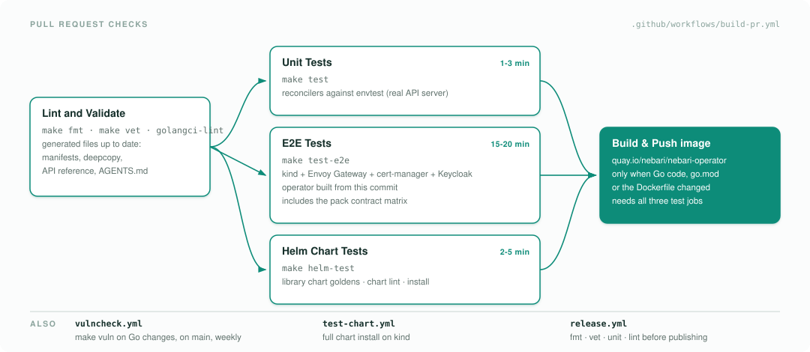
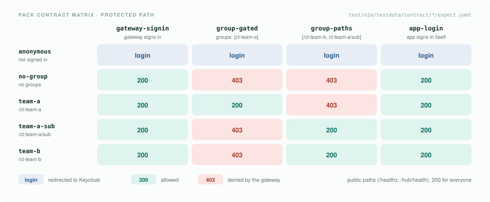

# What we test

This page maps the operator's tests and CI gates: what each layer checks, how to run it, where CI runs it, and
what it does not cover. It links to the tests themselves instead of listing them, so the source stays the
reference.

| Layer | Question it answers | Run it | CI job |
| --- | --- | --- | --- |
| Lint and generated files | Is the code clean, and are CRDs, RBAC, deepcopy, the API reference and `AGENTS.md` regenerated? | `make fmt vet lint`, `make generate-dev docs agents` | Lint and Validate |
| Unit tests | Does each reconciler do its own job against a real API server? | `make test` | Unit Tests |
| End-to-end tests | Does the operator work on a real cluster with Envoy Gateway, cert-manager and Keycloak? | `make test-e2e` | E2E Tests |
| Pack contract matrix | Do packs and their users still get what they got before? | part of `make test-e2e` | E2E Tests |
| Helm chart tests | Does the `nebari-app` library chart still render the same manifests? | `make helm-test` | Helm Chart Tests |
| Vulnerabilities | Is a known vulnerability reachable from our code when a fix exists? | `make vuln` | Vulnerabilities |

## How CI gates a pull request

<picture>
  <source media="(prefers-color-scheme: dark)" srcset="../assets/diagrams/ci-checks-dark.svg">
  
</picture>

`build-pr.yml` runs lint first, then the three test jobs in parallel. The image is built and pushed to
`quay.io/nebari/nebari-operator` only when all three pass and the change touches Go code, `go.mod` or the
`Dockerfile`. The E2E job is capped at 30 minutes.

Three other workflows run alongside it:

- `vulncheck.yml` runs `make vuln` on pull requests that touch Go code or dependencies, on pushes to `main`,
  and weekly on `main`, because new advisories appear without any change here.
- `test-chart.yml` installs the operator's generated Helm chart on a kind cluster.
- `release.yml` runs fmt, vet, unit tests and lint before it publishes manifests, images and the chart. See
  [release-process.md](release-process.md).

## Unit tests

`make test` runs every package outside `test/e2e` against
[envtest](https://book.kubebuilder.io/reference/envtest.html), a real kube-apiserver and etcd with no kubelet.
Reconcilers create, update and delete real objects, but no pod ever runs and no request reaches a gateway.
The tests live next to the code they cover, under `api/v1`, `internal/config` and `internal/controller/...`.
Keycloak calls go through the `OIDCProvider` interface, so the auth reconciler is tested against a fake
provider.

Not covered here: anything that needs Envoy Gateway to act on a `SecurityPolicy`, a certificate to be issued,
or Keycloak to answer. That is what the end-to-end tests are for.

## End-to-end tests

`make test-e2e` runs the Ginkgo suite in [`test/e2e`](../../test/e2e) against a kind cluster with Envoy
Gateway, cert-manager and Keycloak installed by `dev/scripts/services/install.sh`, and the operator image built
from the commit under test. It covers:

- reconciliation, status conditions and cleanup on delete;
- routing variations: TLS on and off, path rules, hostnames;
- user-provided TLS secrets and the gateway and cert-manager wiring;
- authentication: Keycloak client provisioning, the `SecurityPolicy`, generic OIDC, and `auth.groups`
  enforced at the gateway;
- validation of bad specs;
- HTTP and HTTPS connectivity through the gateway.

[`test/e2e/README.md`](../../test/e2e/README.md) explains how to run it against an existing cluster
(`USE_EXISTING_CLUSTER=true`) and how to focus on one spec.

Not covered: Kubernetes and Envoy Gateway versions other than the ones the dev setup installs, and per-app
certificates. CI deploys the operator without `TLS_CLUSTER_ISSUER_NAME`, so apps are served through the
shared wildcard listener and no per-app `Certificate` is issued.

## Pack contract matrix

The other tests check what the operator creates. The contract matrix checks what packs and their users get.
Keycloak users sign in through the real browser flow to sample apps copied from real packs, and the test
compares the HTTP result of every path, plus the `azp` and `groups` claims each app receives, with the app's
`expect.yaml`.

<picture>
  <source media="(prefers-color-scheme: dark)" srcset="../assets/diagrams/persona-matrix-dark.svg">
  
</picture>

It also covers `publicRoutes`: every sample app has a public path that must return 200 to everyone.

When a change alters what a user gets, the test fails and lists every result that differs. If the change is
intended, update `expect.yaml` in the same PR so reviewers see what changes for packs, the same way Helm
goldens work. The users, the sample apps, the `expect.yaml` format and how to add an app are in
[`test/e2e/testdata/contract/README.md`](../../test/e2e/testdata/contract/README.md).

The spec skips itself when Keycloak or the gateway is missing, so check that the E2E log prints the matrix
before you trust a green run.

Not covered yet: more pack shapes are planned under
[#224](https://github.com/nebari-dev/nebari-operator/issues/224), as is an upgrade check that installs the
last release, applies the sample apps, upgrades, and compares. The `issuer-url` key of the client Secret is
also untested, because the dev setup does not set `KEYCLOAK_EXTERNAL_URL`.

## Helm chart tests

`make helm-test` renders the `nebari-app` library chart for each case in
[`test/helm/nebari-app/templates`](../../test/helm/nebari-app/templates) and compares the output with the
committed goldens in `test/helm/nebari-app/golden`. When a template change is intended, regenerate with
`make helm-test-generate-golden` and commit the new goldens; the diff is what reviewers check.
`make helm-lint-library` lints the chart.

## Vulnerabilities

`make vuln` runs [govulncheck](https://go.dev/doc/security/vuln/) and fails when a vulnerability is reachable
from the operator's code and a fixed version exists. Advisories that are not reachable, or have no fix yet,
are listed but do not fail. When it fails, bump the module, or the Go version in `go.mod`, to the version it
names. See [makefile-reference.md](../makefile-reference.md#make-vuln).

It checks Go dependencies only. The container image's base layers are not scanned.
